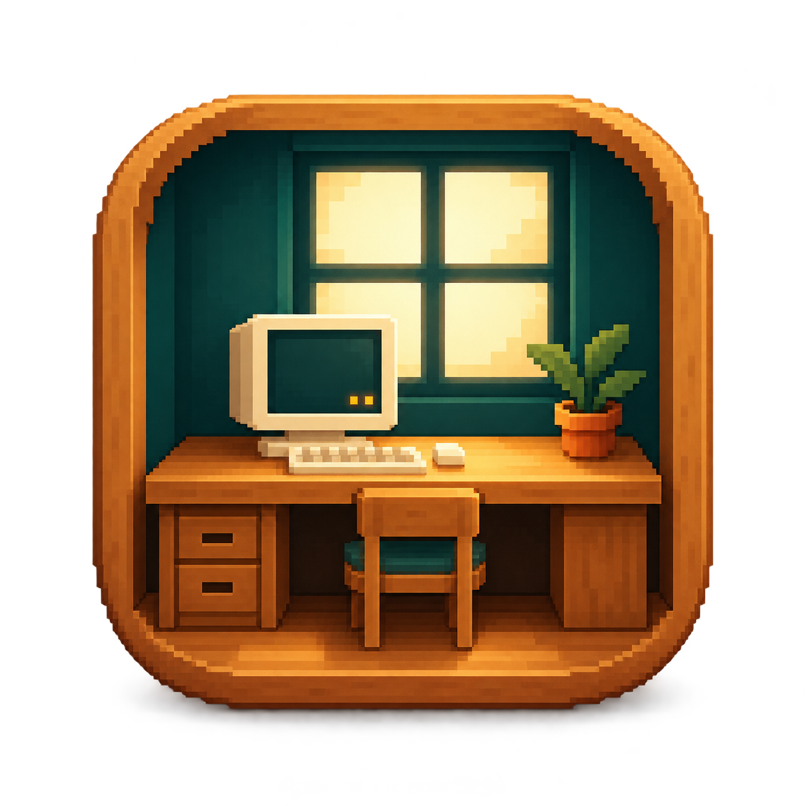
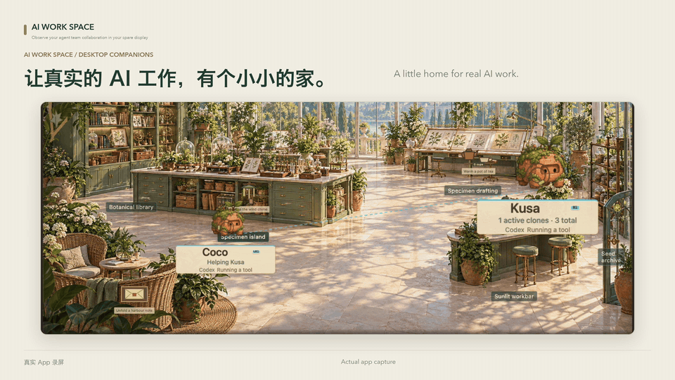
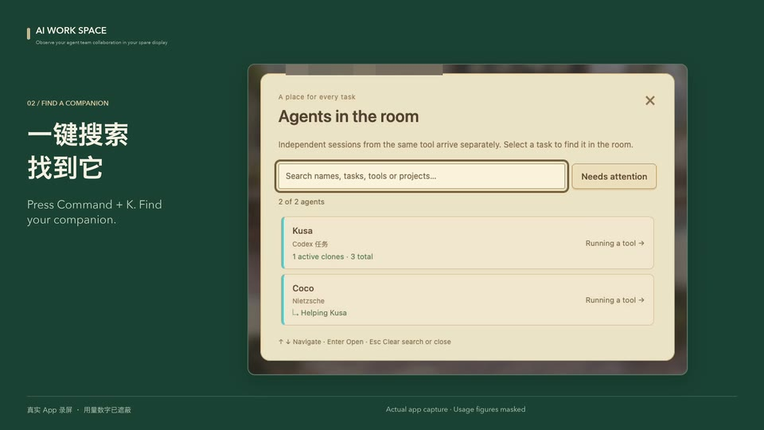
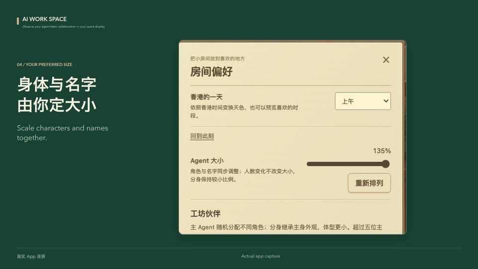
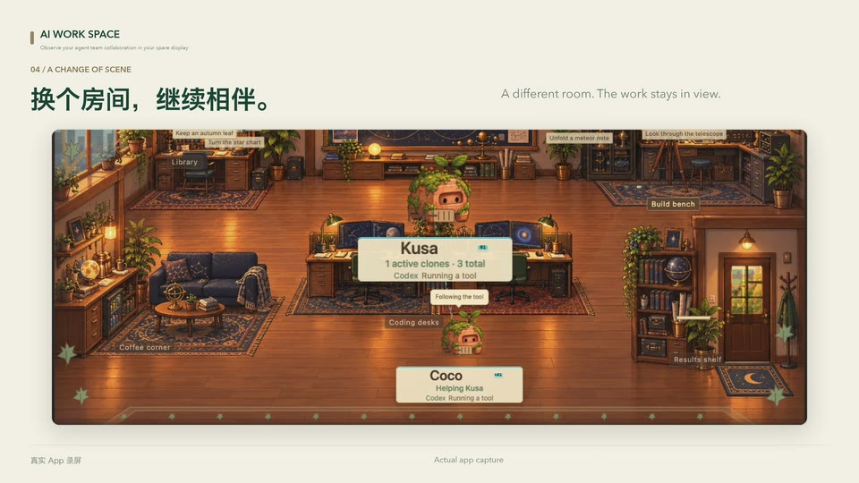

<p align="center">
  
</p>

<h1 align="center">AI Work Space</h1>
<p align="center"><strong>Observe your agent team collaboration in your spare display</strong></p>
<p align="center"><a href="README.md">English</a> · <a href="README.zh-CN.md">简体中文</a></p>
<p align="center">
  <a href="https://github.com/Ye-0413/AI-Office-Workspace/stargazers"></a>
  <a href="https://github.com/Ye-0413/AI-Office-Workspace/releases/tag/v0.24.0"></a>
  <a href="#quick-start"></a>
  <a href="LICENSE"></a>
</p>
<p align="center">
  <a href="#demo">Demo</a> · <a href="#features">Features</a> · <a href="#quick-start">Quick Start</a> · <a href="#agent-tools">Agent tools</a> · <a href="#companions">Companions</a> · <a href="#docs">Docs</a>
</p>

<a id="demo"></a>

<a href="https://github.com/Ye-0413/AI-Office-Workspace/releases/download/v0.24.0/AI-Work-Space-brand-40s.mp4">
  <picture>
    <source media="(prefers-reduced-motion: reduce)" srcset="docs/media/ai-work-space-preview.jpg">
    
  </picture>
</a>

<p align="center"><strong><a href="https://github.com/Ye-0413/AI-Office-Workspace/releases/download/v0.24.0/AI-Work-Space-brand-40s.mp4">▶ Watch the 40-second brand film</a></strong></p>
<p align="center">
  <a href="https://github.com/Ye-0413/AI-Office-Workspace/releases/download/v0.24.0/AI-Work-Space-product-tour-60s.mp4">60s · Product tour</a> · <a href="https://github.com/Ye-0413/AI-Office-Workspace/releases/download/v0.24.0/AI-Work-Space-social-20s-vertical.mp4">20s · Vertical</a> · <a href="https://github.com/Ye-0413/AI-Office-Workspace/releases/download/v0.24.0/AI-Work-Space-loop-12s-silent.mp4">12s · Silent loop</a>
</p>

A quiet macOS studio for real **Codex, Claude Code, Cursor, OpenCode** sessions and helpers, on a **5-inch, 1280 × 720 spare display** or ordinary window.

*Real v0.24.0 recordings, updated branding, bilingual captions; gallery demonstrations are labeled. [Media details](docs/media/README.md).*

<a id="find-a-companion-follow-the-work"></a>

<a id="features"></a>

## Features

- **Real families:** session identity, ancestry and smaller helpers across 11 observed activities.
- **Fixed readable sizes:** 65%–135% bodies and nameplates; settled work positions stay separate.
- **⌘K search:** find by name, task, tool, project or ID; inspect and locate.
- **Local usage:** seven tools’ daily/weekly Token totals and model breakdowns; filter activity history and export it as CSV.
- **Local data:** no cloud account, API key or telemetry; you choose connections and submit supported answers.
- **Quiet company:** reduced motion, low-power mode, hidden-window pauses, optional visitors and 12 pair interactions.

| Find with ⌘K | Keep everyone readable |
| :---: | :---: |
|  |  |

<a id="get-the-studio"></a>

<a id="quick-start"></a>

## Quick Start

| Platform | Download v0.24.0 |
| --- | --- |
| **macOS 13+ · Apple Silicon / arm64** | [DMG](https://github.com/Ye-0413/AI-Office-Workspace/releases/download/v0.24.0/AI-Mini-Office-0.24.0-arm64.dmg) · [ZIP](https://github.com/Ye-0413/AI-Office-Workspace/releases/download/v0.24.0/AI-Mini-Office-0.24.0-arm64.zip) · [Checksums](https://github.com/Ye-0413/AI-Office-Workspace/releases/download/v0.24.0/SHA256SUMS.txt) |

1. Download a DMG or ZIP above; the Electron runtime is included.
2. Move **AI Mini Office.app** to Applications and open it.
3. Connect your tools, then start working in the original client.

Release v0.24.0 uses **AI Mini Office.app**; source builds use **AI Work Space.app**. Ad-hoc signed, **not Apple-notarized**; verify checksums before opening.

<a id="run-from-source"></a>

<details>
<summary>Build from source</summary>

Requires macOS, Node.js 24+ and Xcode Command Line Tools. App commands use `office/`; root commands belong to the upstream reference.

```sh
git clone https://github.com/Ye-0413/AI-Office-Workspace.git
cd AI-Office-Workspace
npm --prefix office ci
npm --prefix office test
npm --prefix office start
npm --prefix office run verify:renderer
npm --prefix office run build:mac
```

Builds appear in `dist-mini-office/`. Workshop artwork is included. [Development guide](office/README.md).

</details>

<a id="agent-tools"></a>

## Supported agent tools

**28 tools. One shared workspace.**

<table width="100%">
  <tr>
    <td align="left" width="240"> &nbsp;<strong>Codex CLI</strong></td>
    <td align="left" width="240"> &nbsp;<strong>Claude Code</strong></td>
    <td align="left" width="240"> &nbsp;<strong>Cursor Agent</strong></td>
    <td align="left" width="240"> &nbsp;<strong>Copilot CLI</strong></td>
  </tr>
  <tr>
    <td align="left" width="240"> &nbsp;<strong>Gemini CLI</strong></td>
    <td align="left" width="240"> &nbsp;<strong>OpenCode</strong></td>
    <td align="left" width="240"> &nbsp;<strong>OpenClaw</strong></td>
    <td align="left" width="240"> &nbsp;<strong>Hermes Agent</strong></td>
  </tr>
  <tr>
    <td align="left" width="240"> &nbsp;<strong>Kimi Code</strong></td>
    <td align="left" width="240"> &nbsp;<strong>Qwen Code</strong></td>
    <td align="left" width="240"> &nbsp;<strong>MiMo Code</strong></td>
    <td align="left" width="240"> &nbsp;<strong>MiniMax Code</strong></td>
  </tr>
  <tr>
    <td align="left" width="240"> &nbsp;<strong>Pi</strong></td>
    <td align="left" width="240"> &nbsp;<strong>OMP</strong></td>
    <td align="left" width="240"> &nbsp;<strong>CodeBuddy</strong></td>
    <td align="left" width="240"> &nbsp;<strong>TraeCode</strong></td>
  </tr>
  <tr>
    <td align="left" width="240"> &nbsp;<strong>Kiro CLI</strong></td>
    <td align="left" width="240"> &nbsp;<strong>KiroCrew</strong></td>
    <td align="left" width="240"> &nbsp;<strong>Antigravity CLI</strong></td>
    <td align="left" width="240"> &nbsp;<strong>Qoder</strong></td>
  </tr>
  <tr>
    <td align="left" width="240"> &nbsp;<strong>QoderWork</strong></td>
    <td align="left" width="240"> &nbsp;<strong>QwenWork</strong></td>
    <td align="left" width="240"> &nbsp;<strong>WorkBuddy</strong></td>
    <td align="left" width="240"> &nbsp;<strong>Grok Build</strong></td>
  </tr>
  <tr>
    <td align="left" width="240"> &nbsp;<strong>CodeWhale</strong></td>
    <td align="left" width="240"> &nbsp;<strong>ZCode</strong></td>
    <td align="left" width="240"> &nbsp;<strong>Reasonix</strong></td>
    <td align="left" width="240"> &nbsp;<strong>DeepSeek Harness<sup>*</sup></strong></td>
  </tr>
</table>

All 28 have configuration/event regression coverage; Codex has real multi-agent verification. Others need live-session checks. *DeepSeek Harness is experimental.*

<details>
<summary>Connection types, Token accounting and native questions</summary>

Activity arrives through hooks, plugins, extensions and supported local logs. Available events depend on each host and version.

| Additional coverage | Supported tools |
| --- | --- |
| **Local Token accounting · 7** | Codex · Claude Code · Gemini CLI · Pi · OMP · Kimi Code · OpenCode |
| **Manual native questions** | OpenCode 1.x ≥ 1.18.31 · MiMo Code 0.1.x ≥ 0.1.15 |

Native answers require your explicit submission; tool approvals stay in the original client. [Compatibility](office/docs/upstream-compatibility.md) · [Usage coverage](office/docs/monitoring.md#actual-coverage) · [Icon credits](docs/media/tool-icons/README.md)

</details>

<a id="companions"></a>

## Meet the workshop

<picture>
  <source media="(prefers-reduced-motion: reduce)" srcset="docs/animations/workshop-demo.png">
  
</picture>

| Folio · 纸团 | Ink · 墨豆 | Moss · 苔盒 | Thread · 线团 | Glow · 灯籽 |
| :---: | :---: | :---: | :---: | :---: |
| Folded paper | Flowing ink | Clay & moss | Coral yarn | Amber light |
| Writing & research | Coding & debugging | Long tasks & care | Design & exploration | Coordination |
| Earnest · meticulous | Quiet · determined | Steady · patient | Playful · inventive | Gentle · precise |

**550 motions = 5 companions × 11 activities × 10 variations.** Roles are personality themes; all five support every activity. Offline animation samples with synthetic sessions. [Motion gallery](docs/animations/README.md).

First five families: distinct designs; additional families: color variants. Helpers inherit their root's **shape and color, at a smaller size**. [Stories & family rules](docs/companions.md).

<a id="from-the-observatory-to-33-daily--holiday-rooms"></a>

## Rooms



From the observatory to **33 daily & holiday rooms**: follow the Hong Kong calendar, daylight or your own choice, in English or 中文. [Explore the rooms →](docs/rooms/README.md)

<a id="docs"></a>

## Guides

| Find your way | Guide |
| --- | --- |
| Setup, settings & local data | [App guide](office/README.md) |
| Connect AI tools | [Compatibility](office/docs/upstream-compatibility.md) |
| Activity, usage & native questions | [Monitoring](office/docs/monitoring.md) |
| Character stories & 550 motions | [Companions](docs/companions.md) · [Animation gallery](docs/animations/README.md) |
| Rooms & recordings | [Room gallery](docs/rooms/README.md) · [Media details](docs/media/README.md) |
| What's changed | [v0.24.0](docs/releases/release-v0.24.0.md) · [Release index](docs/releases/README.md) |

## Contributing

Start with the [development guide](office/README.md); run `npm --prefix office test` before submitting app changes.

## License & credits

**Code:** [AGPL-3.0-only](LICENSE), building on [Clawd on Desk](UPSTREAM-README.md). **Character art:** [All Rights Reserved](office/assets/WORKSHOP-ARTWORK-NOTICE.md). User-supplied character concepts, AI-assisted artwork, project-authored rendering and motion.

[Originality & provenance](ORIGINALITY.md) · [Third-party notices](NOTICE.md) · [App credits](office/UPSTREAM-NOTICE.md) · [Release index](docs/releases/README.md)

English / [简体中文](README.zh-CN.md) document this project; other language READMEs preserve upstream content.

## Star History

<p align="center">
  <a href="https://www.star-history.com/?repos=Ye-0413%2FAI-Office-Workspace&amp;type=date">
    <picture>
      <source media="(prefers-color-scheme: dark)" srcset="https://api.star-history.com/svg?repos=Ye-0413/AI-Office-Workspace&amp;type=Date&amp;theme=dark">
      <source media="(prefers-color-scheme: light)" srcset="https://api.star-history.com/svg?repos=Ye-0413/AI-Office-Workspace&amp;type=Date">
      
    </picture>
  </a>
</p>
