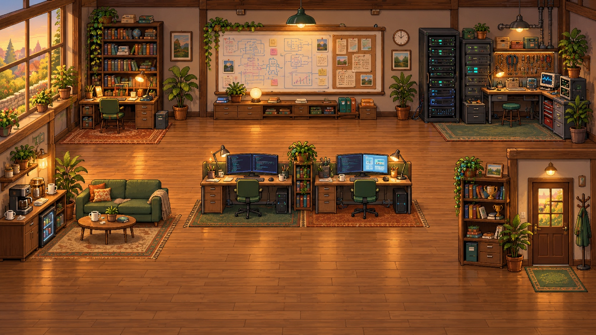
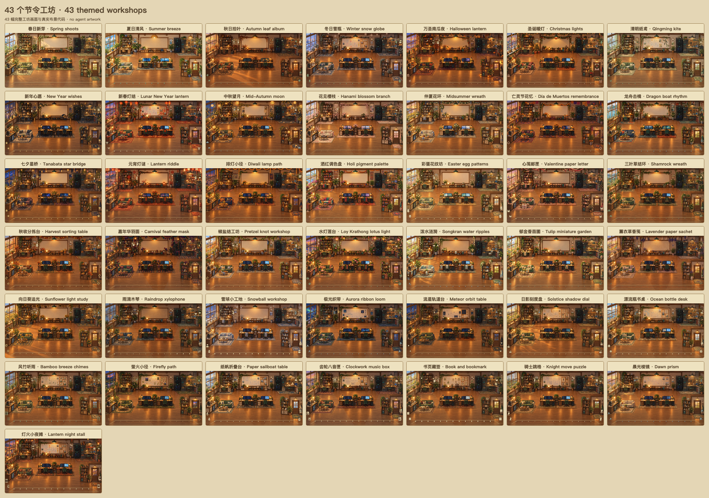
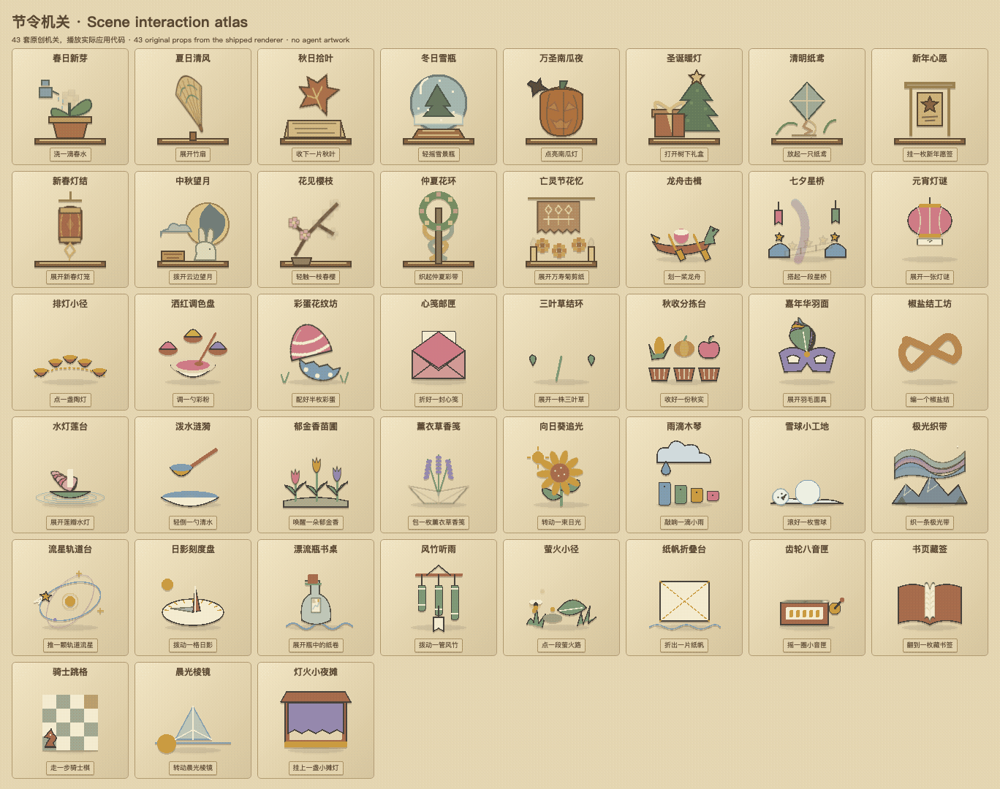

# AI Office Workspace · 小小工作室

一个把真实 AI 活动变成房间日常的 macOS 桌面应用，为 5 英寸、1280 × 720 副屏设计。当前版本 **0.15.0**。

[](https://github.com/Ye-0413/AI-Office-Workspace/actions/workflows/office-quality.yml)

## 当前动画 · 11 类 × 8 种 = 88 种

阅读、搜索、思考规划、写代码、设计、测试、构建、命令执行、等待工具、等待用户与异常排查，每类都有八套不同的关节动作和工作道具。下面同时播放每类的一个例子。


**[查看全部 88 种动画 GIF 图鉴 →](docs/animations/README.md)** · [静态总览](docs/animations/overview.png)

公开预览使用原创示意角色，播放应用当前的关节动画与道具；此处不展示受限角色外观。图集为离线演示，不代表真实任务或工具结果。图集同步为 12 秒循环，应用保留实际动作节奏；同类动作按约 18–24 秒可见工作时间轮换，切换场景后继续累计。

新增的步态与分身特效也可直接预览（原创示意外观）：


- 所有项目的主 Agent 与分身在同一层同时显示；多个 Codex session 保留独立身份，家族颜色、组号与真实父子连线帮助辨识。
- 中文昵称取意于神话、山海、星宿与文房；英文界面使用独立英文昵称。
- 主 Agent 的身体从门口真实走入；分身在实际父级身上凝聚，再走向工作区，结束后走回父级并吸收，显示「结束分身。」。短暂工具切换会合并，持续活动才改变目的地。
- 多人确认退场后，会先验证真实离场路线；能沿原尺寸走出时保留共同尺寸，位置释放后再自动恢复更大尺寸。分身、归返和离场状态随中英文切换同步翻译。
- 留场等待分身的父 Agent 保持实际脚点，其他角色换工作区不会借用它的移动权限；新工作恢复、首次回泊和最终退场分别按真实状态接续。
- 四足步态与位置同步，走停从当前关节和道具续接；最多四条已核验的路线并行。通道暂满时等待或让路，已入场身体持续可见，待入场数量明确显示。
- Agent 与名牌的偏好大小为 65%–135%；拥挤时全体等比例适配，显示实际比例。脚底锚定地面，缩放与路线可从当前画面打断，普通快照不重建身体、不重播动作。
- 新工作可打断分身归位并续接原动作；名牌增长、调整大小不会截断回收。角色图片暂时失效时显示同位置的原创备用身体，恢复时平滑衔接。
- 场景跟随香港的一天，木窗与门窗同步变化；时钟显示时间、完整日期和星期，旁边统计今日已观察到的活跃 Agent。
- 「使用记录」将已观测的身份、主子关系、活动、工作／等待时长和调用次数持久保存在本机；可按日期、工具和关系筛选，查看时间线或导出 CSV，重启后仍在。
- 连接面板提供「一键初始化」：自动识别本机已有工具，逐项安装或更新观察配置，保留原配置与备份；失败可单独重试，原工具的信任确认仍清楚标出。
- 支持中文／English、细雨、减少动作和节能观察；空闲访客有 10 个区域与 500 条中英双语气泡。
- 工具目录对齐 28 种 Agent；只观察活动，审批和回答继续在原 AI 工具中完成。

<details>
<summary>查看工作室场景背景</summary>



</details>

## 场景与小互动

三种室内背景：**山海工坊、港湾茶舍、星台观测室**。各有三种机关和三套双 Agent 互动：递图纸、纸飞机、拼磁贴；敬茶、传茶点、风铃应答；共绘星线、传星笺、一起看流星。双人互动持续 2.8–3.2 秒，只改变原创装饰，不改变真实工作、位置或会话。

山海工坊有 **43 幅完整节令房间画面**，分别重绘织物、桌面器物、墙面陈设与窗外氛围；家具和通道保留同一布局。港湾茶舍与星台保留各自室内画面，配合节令布景。



节令库有 **43 套机关主题**，每套 41 个连续运动采样，点击后可改变实际机关状态；四季、万圣节、圣诞节、清明、新年、新春、中秋、赏樱、仲夏与墨西哥亡灵节等保持统一的温暖像素风格。场景设计和动画由独立 Agent 交叉审查，快速重复操作也从当前画面续接。



[查看场景、玩法、日期规则与动画清单](docs/scenes/README.md)。自动模式按香港日期选择已核实的节日及四季；其它文化或季节灵感可手动预览。雨雪是可选择的装饰天气。预览始终保留真实香港时钟、日期与星期。

## 运行与构建

主应用位于 `office/`。根目录的 `agents/`、`hooks/`、`src/` 等保留为集成注册表与参考源码；请从 `office/` 运行应用。

需要 macOS 13+ 和 Node.js 24+，本地验证目标为 Apple Silicon。

```sh
git clone https://github.com/Ye-0413/AI-Office-Workspace.git
cd AI-Office-Workspace/office
npm ci

# 从你本地、已取得使用权限的原项目目录准备角色素材。
node scripts/prepare-local-artwork.cjs --from /absolute/path/to/original-project

npm test
npm start
# 生成本地 .app、DMG 和 ZIP：
npm run build:mac
```

素材准备脚本不会联网；它核对固定版本的 50 个 SVG 和图标的 SHA-256，然后仅写入本项目的本地素材目录。原素材来自 [原项目](https://github.com/rullerzhou-afk/clawd-on-desk)，对应版本 `c52e2df6ff778bf85310166882c516385f2f6eab`。

构建产物位于 `dist-mini-office/`。安装包包含 Electron／Node 运行时，安装后无需开发服务器。

## 素材与许可

代码使用 **AGPL-3.0-only**，详见 [LICENSE](LICENSE)。代码许可不覆盖原角色素材；原素材声明保留所有权利并限制再分发，详见 [素材许可](office/assets/ORIGINAL-ARTWORK-LICENSE.txt)。公开源码不包含这些受限素材，也不发布含有这些素材的安装包；拥有相应权限后才能使用或分发。生成的房间背景及其原始提示随 `office/assets/` 和 `office/docs/` 保留。

原项目的代码、集成注册表和相关通知保留用于溯源，见 [第三方通知](office/UPSTREAM-NOTICE.md) 与 [参考项目说明](UPSTREAM-README.md)。

## 验证与边界

Office quality 在每次 main 推送与 PR 上运行自动测试及原生观察锁检查。动画图鉴核对全部 88 种真实程序、GIF 动画帧与源码一致性；原生窗口检查覆盖 100 位角色同屏、逐帧位置连续与无重叠、分身恢复、时钟日期及中英文界面。公开源码检查无需还原角色素材。 百人压力测试检查身份、入场进度与完整包络；极密场景仍需缩小，不表示五英寸屏幕上的百人名牌已达到可读验收。

28 种工具的隔离事件／配置检查，不等同于 28 种真实客户端都已运行。Codex 已有实际活动观察记录；本机 Hermes Gateway 的 11 个观察钩子已确认加载，下一次真实任务仍需实际使用验收。

更多说明见 [应用文档](office/README.md)。
