# 工坊动作图鉴 / Workshop motion gallery

五位伙伴各有 11 类活动，像素风和手绘风各有 **55 套循环**。默认使用像素风，通过「显示 → 头像风格」或「房间偏好 → 头像风格」可切换。房间偏好中的动作图鉴会显示当前风格。

Five companions perform **55 activity loops per style**. Pixel is the default. Switch with **View → Avatar Style** or **Room preferences → Avatar style**. The motion gallery in Room preferences follows your selection.

## 像素风 / Pixel

<picture>
  <source media="(prefers-reduced-motion: reduce)" srcset="pixel-overview.png">
  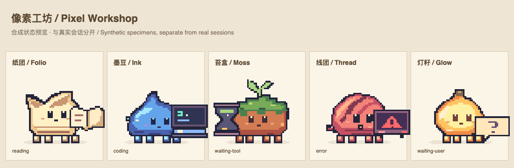
</picture>

五张卡片由原生渲染器使用合成会话采样。预览把循环相位同步到 3 秒，应用按各自的时长播放。The native preview synchronizes five synthetic loops to three seconds. Each activity keeps its own timing in the app.

[静态预览 / Still](pixel-overview.png) · [原创素材声明 / Artwork notice](../../office/assets/WORKSHOP-ARTWORK-NOTICE.md) · [像素帧节拍 / Cel timings](../../office/renderer/creature-frame-manifest.js)

每位伙伴的九张表情帧包括眨眼、左右瞥视、两张招手帧、受惊、两张访客彩蛋帧和工具成功后的轻微表情。眨眼只改变眼睛的像素，身体轮廓和脚底沿用待命姿态。装饰访客偶尔会展示纸鹤、墨泡、苔花、纱线爱心或暖光星星。

Each companion has nine expression cels. The blink changes only the eye pixels. Rare visitor expressions show a paper crane, ink bubble, moss blossom, yarn heart or glowing star. [访客彩蛋预览 / Visitor expression preview](pixel-expressions.png).

## 手绘风 / Painted

<picture>
  <source media="(prefers-reduced-motion: reduce)" srcset="painted-overview.png">
  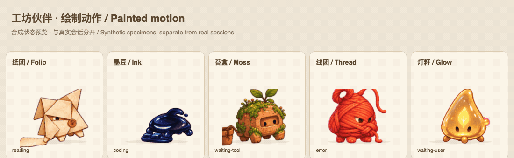
</picture>

上图是原工坊位图渲染器的离线采样。录制用五个合成会话把循环统一为 3 秒、36 帧。应用中的手绘风保留各自原有节拍和帧间过渡。

The archived recording samples five synthetic activities from the painted renderer. The recording normalizes cycles to three seconds and 36 frames for comparison. The app uses each activity's original timing and blends. [静态预览 / Still](painted-overview.png) · [录制清单 / Capture manifest](painted-manifest.json)

手绘风的动作图鉴也保留了每个活动的十套矢量参考动作。The painted gallery also keeps ten vector references per activity.

## 原版录制存档 / Workshop recording archive

以下录制保留原工坊版的 550 套动作库、家具和环境演示，来源见各录制清单。These recordings preserve the previous 550-variation renderer and its furniture and environment demonstrations. [原版总览 / Workshop overview](workshop-demo.svg) · [录制清单 / Recording manifest](manifest.json)

## 十一类活动 / Eleven observed activities

下列 GIF 每张展示原工坊版的五种角色与一个同族小分身。GIF 将原生循环相位同步到 4.2 秒，每张采样 42 帧。

### 阅读 / Reading

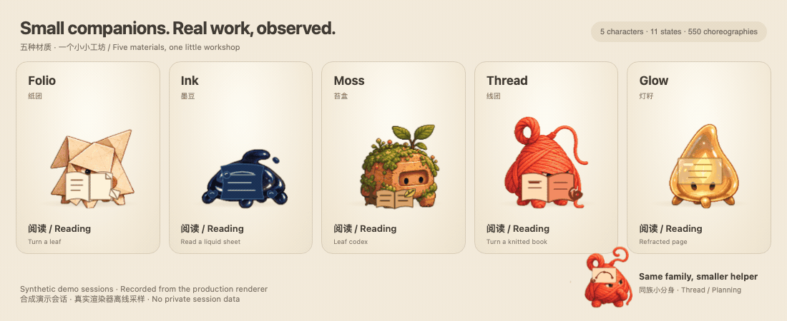

### 检索 / Searching

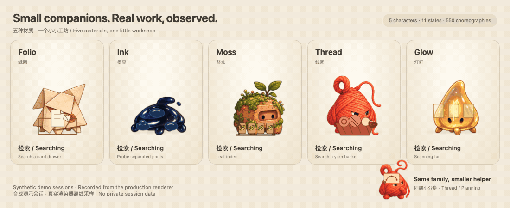

### 构思 / Planning

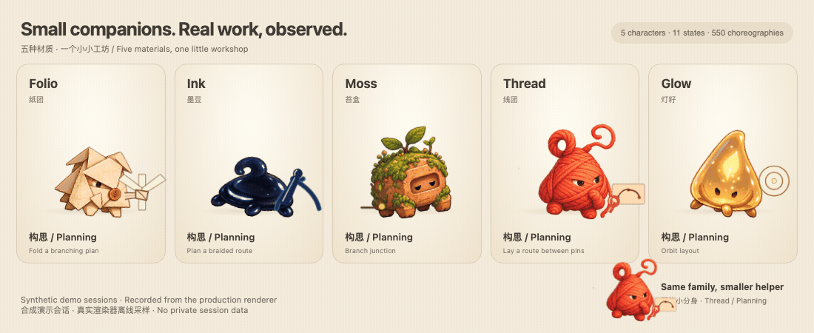

### 编码 / Coding

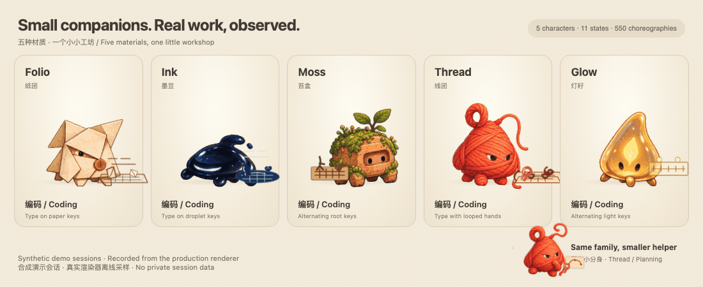

### 设计 / Designing


### 测试 / Testing

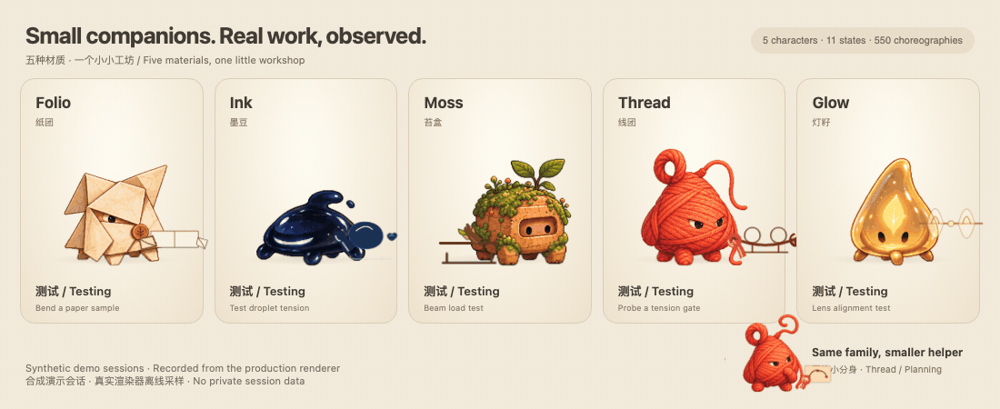

### 构建 / Building

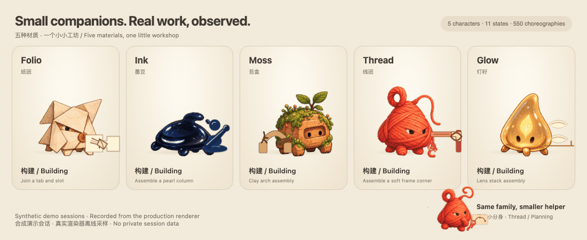

### 运行 / Running

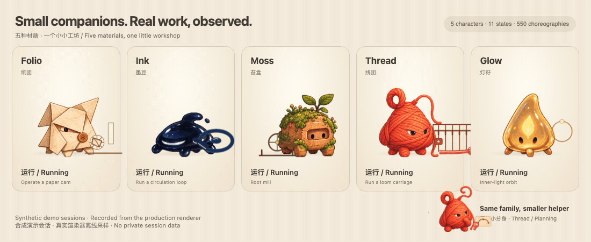

### 等待工具 / Waiting for tools


### 等待用户 / Waiting for you

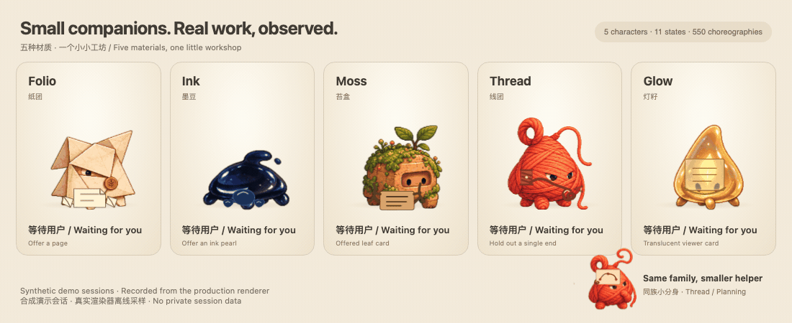

### 异常排查 / Blocked by error

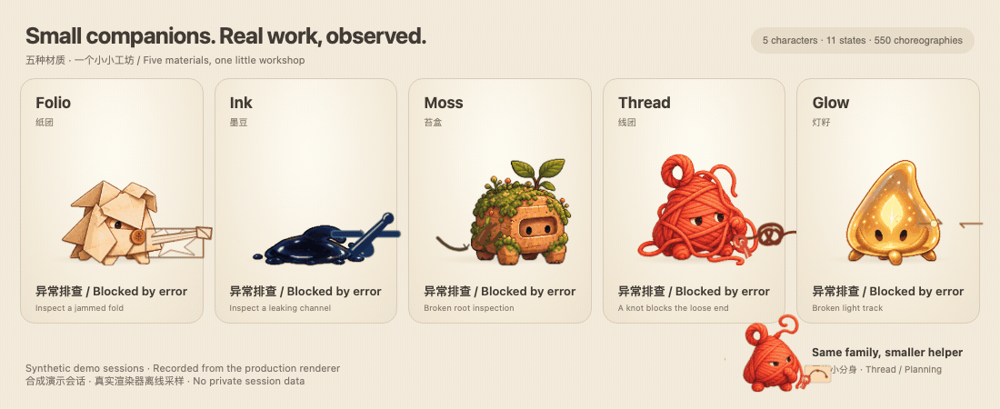

## 独立的家具与互动演示 / Independent prop recordings

这些较早的公开媒体使用项目原创胶囊示意角色或透明端点；它们不是当前五种工坊角色的外观预览。保留它们用于查看真实道具程序，并在各自 manifest 中注明录制版本与范围。没有使用本地恢复的受限角色图片，也不证明真实房间导航、身体接触或 IK。

### 家具到站响应 / Twelve furniture responses

[录制范围与原生采样清单](stations/manifest.json)。三个主题各四种家具，采用真实 `OfficeStationArrival` 程序，48 fps、72 帧。透明合成端点只用来提供锚点。

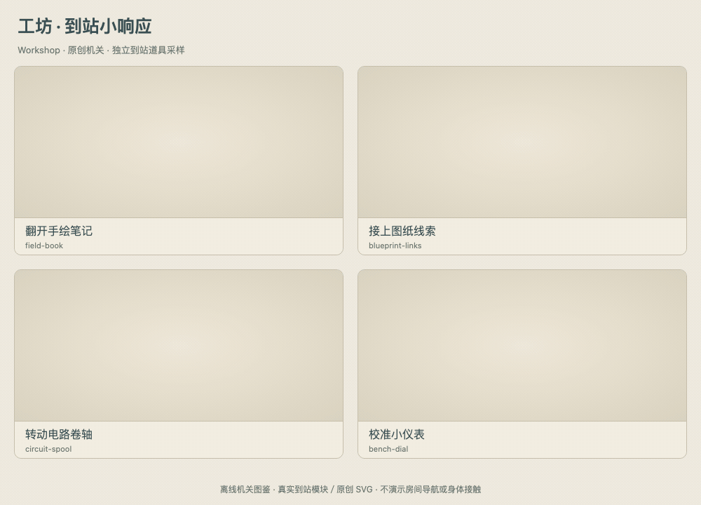
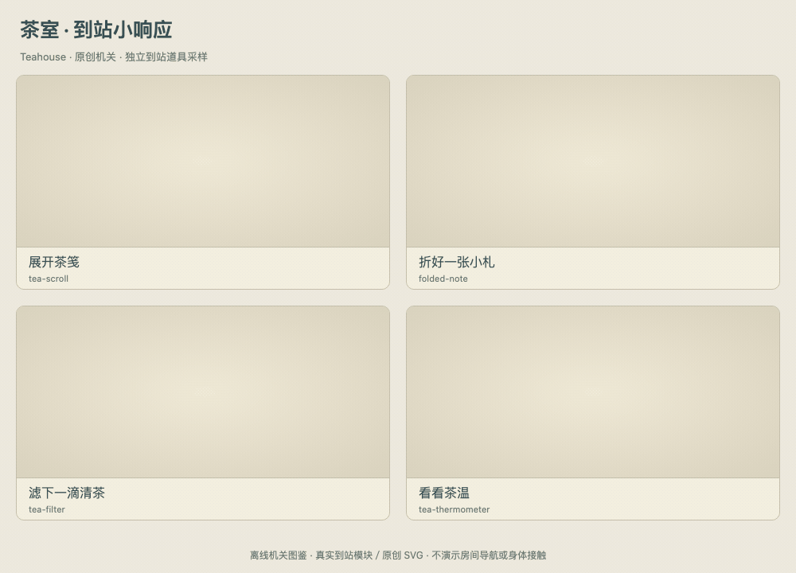
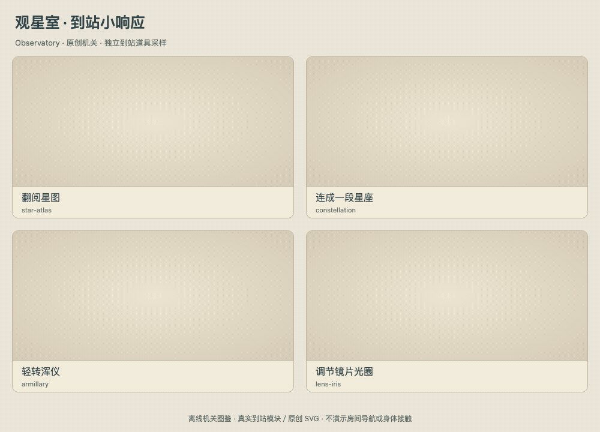

### 双人道具互动 / Twelve pair interactions

[录制范围与原生采样清单](social/manifest.json)。这些是原创胶囊示意角色之间的道具编舞，48 fps、168 帧；不是当前角色身体接触的录屏。

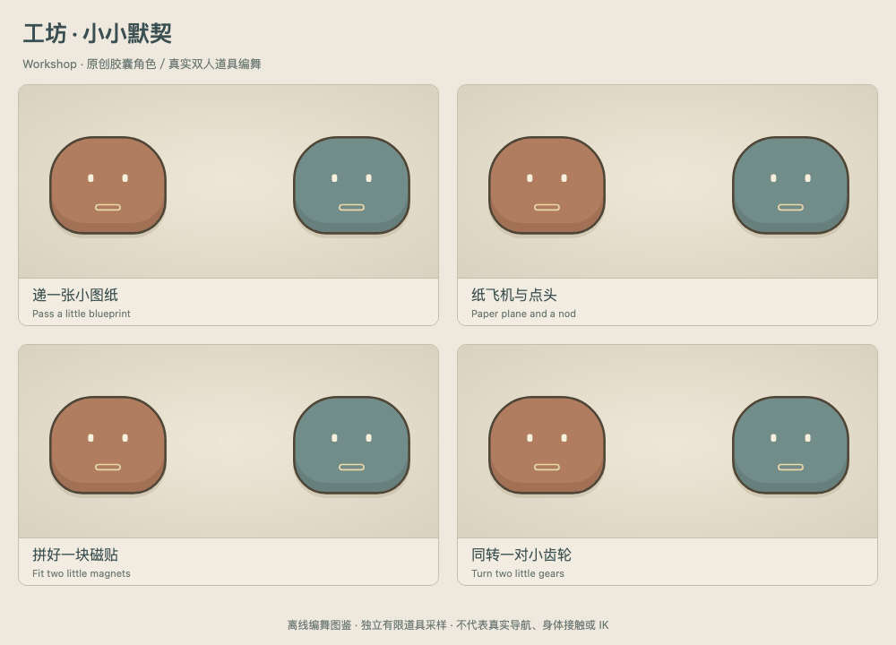
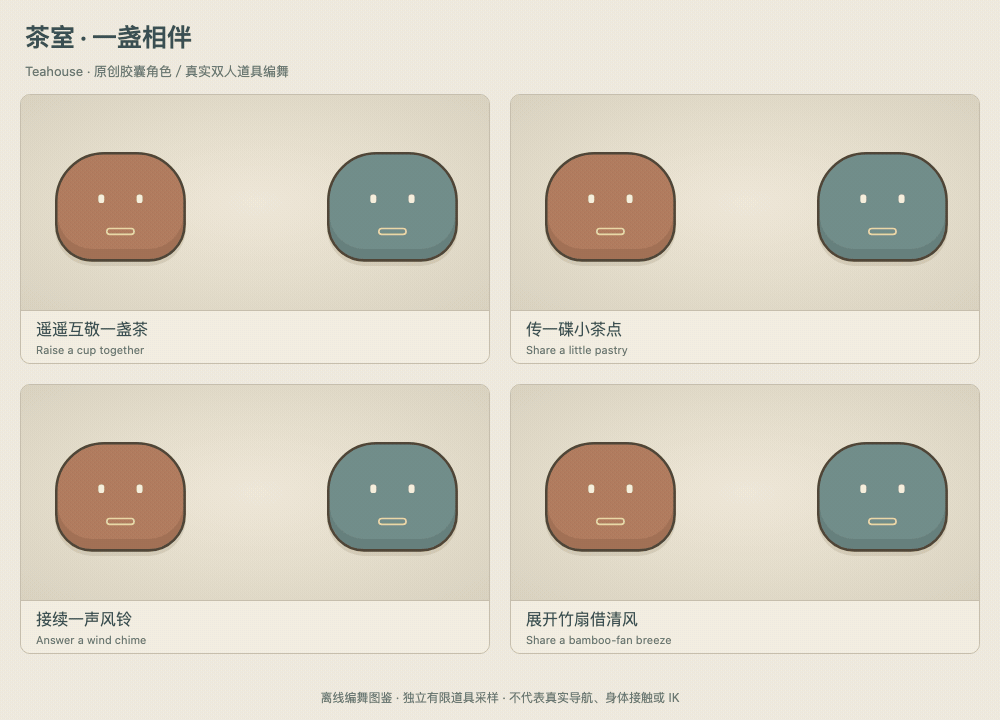
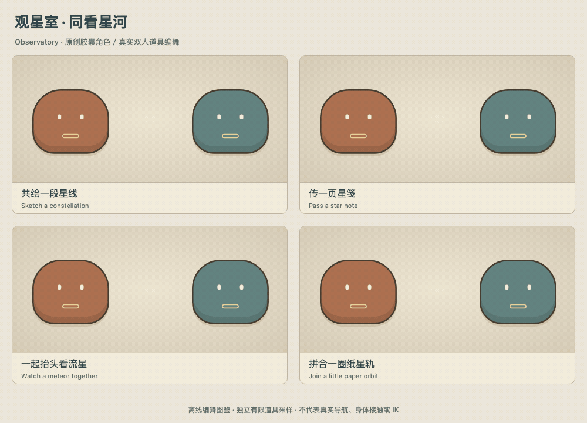

### 旧关节接口参考 / Legacy joint interface reference

[录制范围与原生采样清单](lifecycle/manifest.json)。原创胶囊示意角色展示旧关节接口的距离步态，以及分身凝聚、归返道具。四足在固定锚点演示，不代表当前房间路线或真实脚底接触证明。

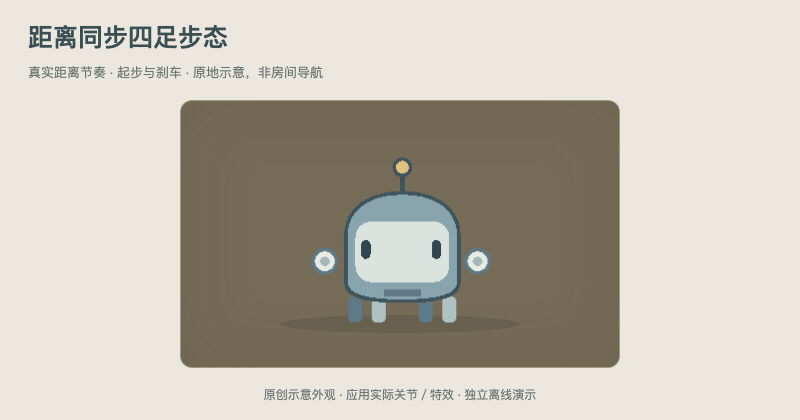
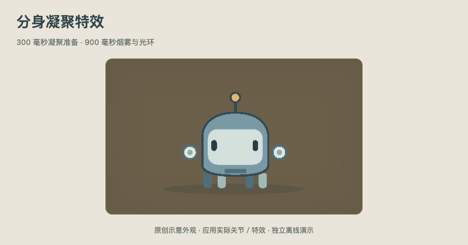
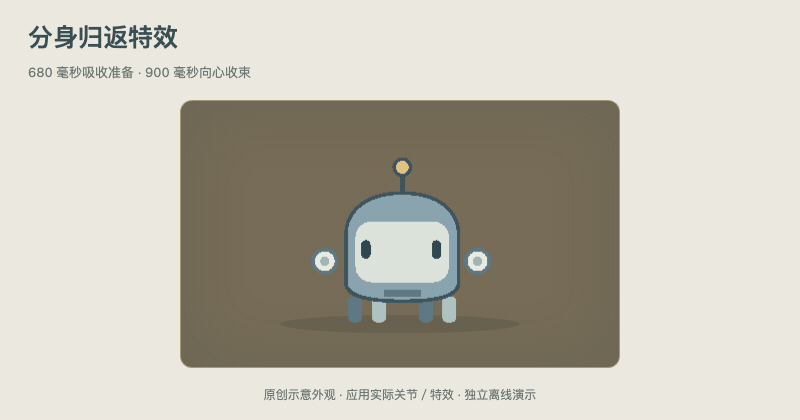

## 重新导出像素预览 / Reproduce the pixel preview

在仓库根目录运行，使用本地 Electron 与 ffmpeg。

```sh
MINI_OFFICE_PREVIEW_DIR=/tmp/office-pixel-preview MINI_OFFICE_CAPTURE_MOTION=1 \
  office/node_modules/.bin/electron office/test/creature-frames-renderer.cjs
ffmpeg -framerate 12 -i /tmp/office-pixel-preview/pixel-%03d.png \
  -filter_complex '[0:v]split[a][b];[a]palettegen=reserve_transparent=0[p];[b][p]paletteuse=dither=none:diff_mode=rectangle' \
  -loop 0 docs/animations/pixel-overview.gif
cp /tmp/office-pixel-preview/pixel-lineup.png docs/animations/pixel-overview.png
cp /tmp/office-pixel-preview/pixel-expressions.png docs/animations/pixel-expressions.png
```

[返回项目首页 / Project home](../../README.md)
