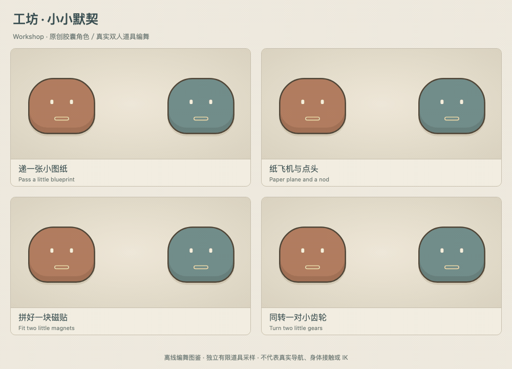
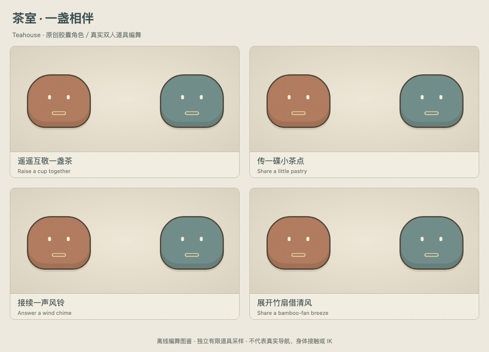
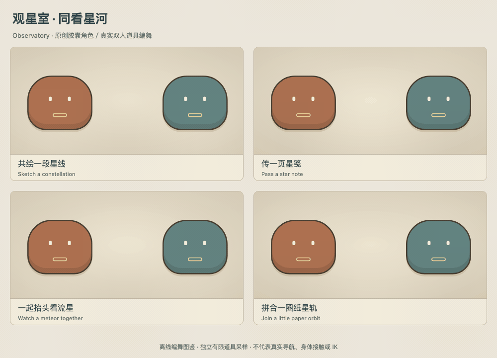
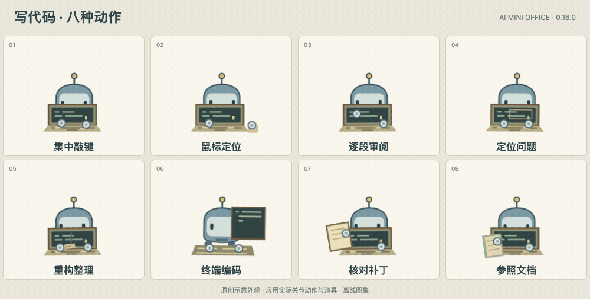
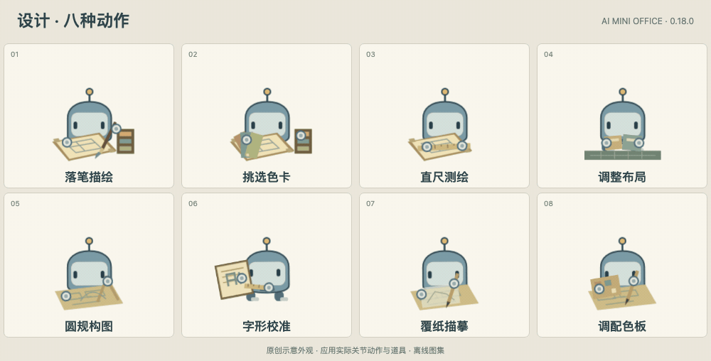
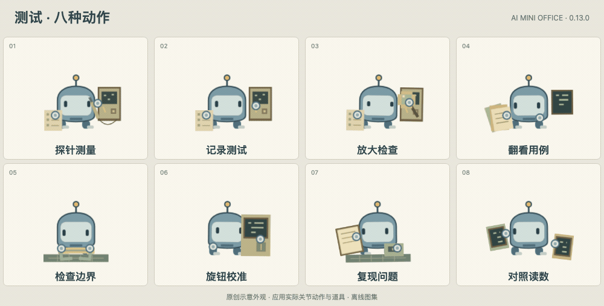
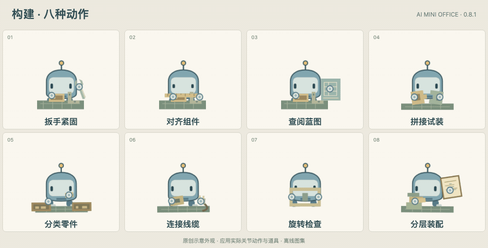
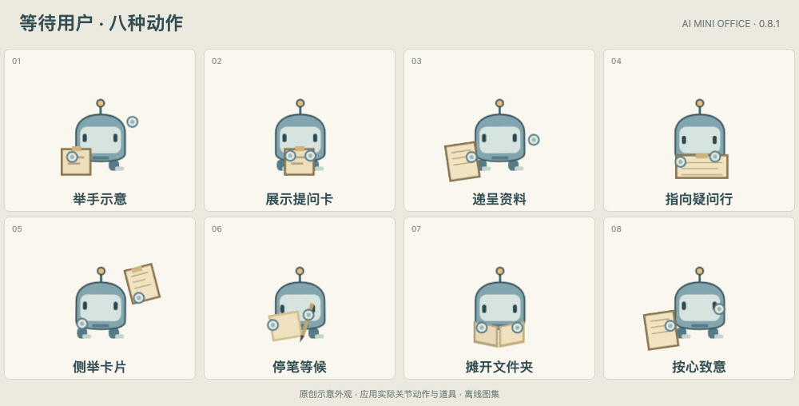

# 动画图鉴 / Animation gallery

当前动画库：11 类活动，每类 8 套，共 **88 套关节动作**。每张分类图同时展示该类的全部八套动作，按从左到右、从上到下排列；展开目录可查看中文名称与对应代码 ID。

公开图集使用原创示意角色，直接播放应用当前的关节动画 CSS 和工作道具；为遵守原角色素材许可，此处不展示正式角色外观。图集是离线动画演示，不代表真实任务、执行进度或工具结果。

图集统一为 12 秒同步循环，方便对照；应用保留自身的动作节奏。

应用根据实际观察到的活动选择动作，同类动作每经过约 18–24 秒可见工作时间自然轮换。普通事件刷新不会重新播放；切换房间、翻页后延续累计时间。减少动作、节能、隐藏窗口和角色走动期间会暂停轮换。

[返回项目首页](../../README.md) · [动作清单与轮换逻辑](../../office/lib/avatar-performance-model.js) · [关节动画 CSS](../../office/renderer/avatar-performance.css) · [角色与工作道具渲染](../../office/renderer/avatar-performance.js)

## 双人互动 · 12 种

三个房间各四种，使用当前真实 `OfficeAgentSocial` 编舞。每段 2.8–3.2 秒；新加入的齿轮对转、竹扇送风和拼合纸轨道各有 41 个连续轨迹采样。每张图按 48 fps 离线采样 168 帧，3.5 秒含短暂道具退场；GIF 的百分之一秒编码时长以[清单](social/manifest.json)为准。





这些公开示意使用原创静态胶囊角色，在固定的示意端点播放实际道具。每个离线时间点创建新的有限道具动画，只采样该道具自己的动画时钟；不修改角色、会话、路线或工作动画。它们展示道具编舞；房间导航、动画中断与清理另由原生测试覆盖。此处不作身体接触、IK 或连续 owner 生命周期的承诺。应用内互动会避开走路、分身、忙碌与拥挤身体，手动点击选择附近伙伴。减少动作、节能和隐藏窗口会停止装饰动作。

## 步态与分身特效

这些是 0.16 的距离同步四足步态与现有分身特效，独立于上面的 88 套工作动作。每张图按 48 fps 采样，共 96 帧，至少有 31 幅不同的实际画面。步态图由应用真实的起停时间模型和距离接口驱动：1800 毫秒内走完 384 个世界像素，对应两个完整步态周期，最后约 200 毫秒静止。角色在公开图中保持原位，只演示关节随距离起步、交替和刹车，**不是实际房间导航或脚底接触证明**。

分身凝聚准备为 300 毫秒，归返准备为 680 毫秒，烟雾、光环与粒子持续 900 毫秒。真实房间路线、父级停靠、身体吸收与碰撞安全另由原生窗口测试验证。


使用同一原创示意角色。资源适配器仅以无图片资源的离线元素提供透明度接口，未改关节步态或特效；不会读取受限角色文件。逐帧调用正式步态接口并保留同一组关节 Animation，使用明确的采样时间，不替换浏览器的 document timeline。可用 `electron scripts/render-lifecycle-previews.cjs` 重新导出，源码摘要、帧数和原地演示范围记于[清单](lifecycle/manifest.json)。

## 阅读 / Reading · 8 种

翻阅、批注、对照与图解阅读，各自有不同的视线、手势和纸面道具。


<details>
<summary>展开八种动作名称与代码 ID</summary>

1. 翻页细读 — `read-turn`
2. 提笔批注 — `read-annotate`
3. 对照阅读 — `read-compare`
4. 展开卷轴 — `read-scroll`
5. 梳理纲要 — `read-outline`
6. 核对脚注 — `read-footnote`
7. 夹入书签 — `read-bookmark`
8. 研读图解 — `read-diagram`

</details>

## 搜索 / Searching · 8 种

检索目录、寻找参考和核对线索，表现查找过程，不宣称已经找到答案。


<details>
<summary>展开八种动作名称与代码 ID</summary>

1. 镜下扫查 — `search-sweep`
2. 翻检索引 — `search-index`
3. 比对资料 — `search-compare`
4. 检索目录 — `search-catalogue`
5. 按图寻线 — `search-map`
6. 拼合线索 — `search-clues`
7. 书架寻书 — `search-shelves`
8. 修订查询 — `search-query`

</details>

## 思考与规划 / Thinking & planning · 8 种

托腮、转笔、拆分任务与推演分支，让不同的思考段落拥有不同的小动作。


<details>
<summary>展开八种动作名称与代码 ID</summary>

1. 托腮思考 — `plan-chin`
2. 转笔酝酿 — `plan-pencil`
3. 绘制思路 — `plan-map`
4. 揉额推敲 — `plan-temple`
5. 拆分任务 — `plan-decompose`
6. 安排顺序 — `plan-sequence`
7. 推演分支 — `plan-branches`
8. 循线复盘 — `plan-trace`

</details>

## 写代码 / Coding · 8 种

敲键、审阅、调试和核对补丁交替呈现；这些姿态表示工作活动，不表示代码已通过验证。



<details>
<summary>展开八种动作名称与代码 ID</summary>

1. 集中敲键 — `code-burst`
2. 鼠标定位 — `code-pointer`
3. 逐段审阅 — `code-review`
4. 定位问题 — `code-debug`
5. 重构整理 — `code-refactor`
6. 终端编码 — `code-terminal`
7. 核对补丁 — `code-patch`
8. 参照文档 — `code-document`

</details>

## 设计 / Designing · 8 种

画笔、色卡、直尺、圆规与描图纸，把设计过程拆成不同的工作场景。



<details>
<summary>展开八种动作名称与代码 ID</summary>

1. 落笔描绘 — `design-brush`
2. 挑选色卡 — `design-swatches`
3. 直尺测绘 — `design-ruler`
4. 调整布局 — `design-layout`
5. 圆规构图 — `design-compass`
6. 字形校准 — `design-type`
7. 覆纸描摹 — `design-trace`
8. 调配色板 — `design-palette`

</details>

## 测试 / Testing · 8 种

探针、用例卡和读数对照表现检查过程，不预先展示测试通过或问题已修复。



<details>
<summary>展开八种动作名称与代码 ID</summary>

1. 探针测量 — `test-measure`
2. 记录测试 — `test-notes`
3. 放大检查 — `test-inspect`
4. 翻看用例 — `test-cases`
5. 检查边界 — `test-boundary`
6. 旋钮校准 — `test-calibrate`
7. 复现问题 — `test-reproduce`
8. 对照读数 — `test-compare`

</details>

## 构建 / Building · 8 种

以原创零件、蓝图和装配工具表达构建活动，包含试装、接线和分层整理。



<details>
<summary>展开八种动作名称与代码 ID</summary>

1. 扳手紧固 — `build-wrench`
2. 对齐组件 — `build-align`
3. 查阅蓝图 — `build-blueprint`
4. 拼接试装 — `build-fit`
5. 分类零件 — `build-sort`
6. 连接线缆 — `build-wire`
7. 旋转检查 — `build-rotate`
8. 分层装配 — `build-stack`

</details>

## 命令执行 / Running · 8 种

终端观察、日志查阅和双屏巡视，显示命令执行时的关注方式，不虚构输出内容。


<details>
<summary>展开八种动作名称与代码 ID</summary>

1. 守望终端 — `run-watch`
2. 随手记要 — `run-notes`
3. 输入命令 — `run-keyboard`
4. 逐行查日志 — `run-log`
5. 滚动查看 — `run-scroll`
6. 双屏巡视 — `run-monitor`
7. 对照参考 — `run-reference`
8. 追踪路径 — `run-trace`

</details>

## 等待工具 / Waiting for tools · 8 种

托腮、停书、拨笔和看表，让等待拥有细节；没有进度条，也不把等待表现为成功。


<details>
<summary>展开八种动作名称与代码 ID</summary>

1. 托腮等候 — `wait-chin`
2. 侧耳聆听 — `wait-listen`
3. 静候终端 — `wait-console`
4. 收整托盘 — `wait-tray`
5. 戴耳机听 — `wait-headset`
6. 夹好书签 — `wait-bookmark`
7. 拨弄铅笔 — `wait-pencil-roll`
8. 看一眼腕表 — `wait-wrist`

</details>

## 等待用户 / Waiting for user · 8 种

举手、呈递资料或停笔，把需要输入的状态表达清楚；工作室不会代替用户作答或审批。



<details>
<summary>展开八种动作名称与代码 ID</summary>

1. 举手示意 — `ask-raised`
2. 展示提问卡 — `ask-card`
3. 递呈资料 — `ask-present`
4. 指向疑问行 — `ask-point-line`
5. 侧举卡片 — `ask-tilt-card`
6. 停笔等候 — `ask-pencil-rest`
7. 摊开文件夹 — `ask-open-folder`
8. 按心致意 — `ask-hand-to-heart`

</details>

## 异常排查 / Error inspection · 8 种

挠头、放大定位、覆片比对与标记问题，呈现遇到异常时的动作，不暗示已自动重试或修复。


<details>
<summary>展开八种动作名称与代码 ID</summary>

1. 挠头疑惑 — `error-scratch`
2. 对照复查 — `error-review`
3. 放大定位 — `error-magnify`
4. 循迹排查 — `error-trace`
5. 覆片比对 — `error-overlay`
6. 查阅参考 — `error-reference`
7. 标记问题处 — `error-mark-place`
8. 放下待查 — `error-set-down`

</details>

## 重新生成预览

需要已安装的应用开发依赖和 `ffmpeg`，无需还原原角色素材。在 `office/` 中运行：

```sh
npx electron scripts/render-animation-previews.cjs
```

生成器使用[原创示意外观](preview-body.js)，在导出前移除全部外部图片引用，并核对 88 种动作覆盖。GIF 与 `manifest.json` 一同更新。
