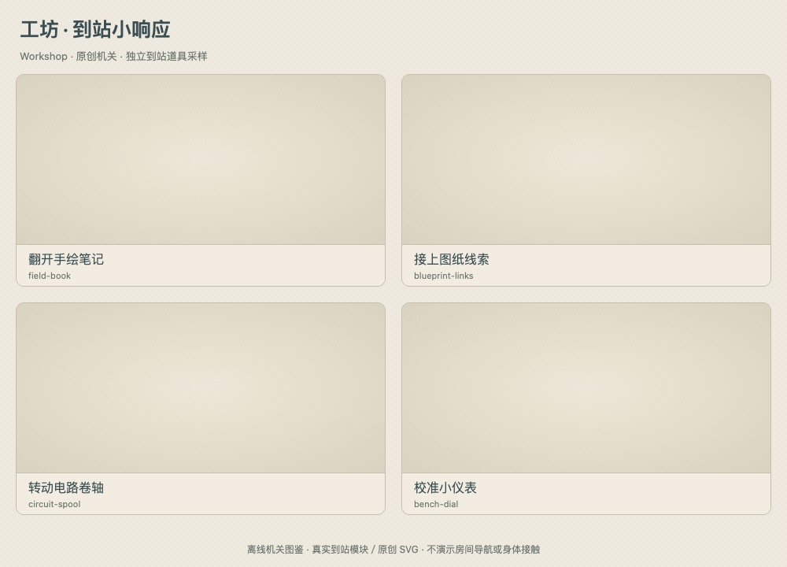
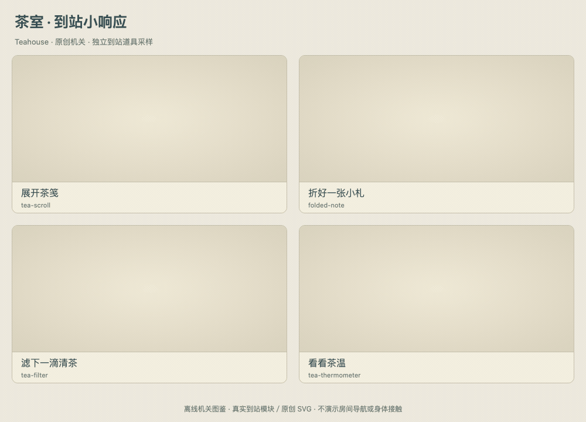
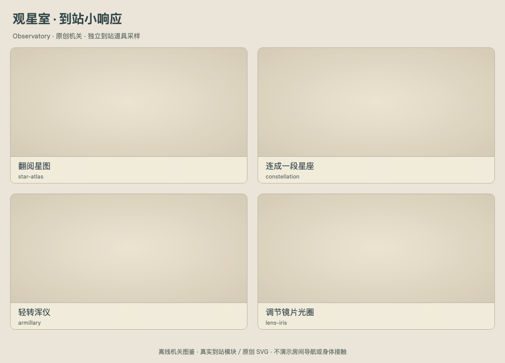

# 工坊动作图鉴 / Workshop animation gallery

当前角色库是五种原创材质伙伴：纸团 **Folio**、墨豆 **Ink**、苔盒 **Moss**、线团 **Thread**、灯籽 **Glow**。每种角色有 11 类活动，每类 10 套动作，共 **550 套状态动作**。角色造型、材质和动作道具不同，不只是换色。

<picture>
  <source media="(prefers-reduced-motion: reduce)" srcset="workshop-demo.png">
  
</picture>

[静态预览 / Static preview](workshop-demo.png) · [录制清单 / Recording manifest](manifest.json) · [原创角色素材声明](../../office/assets/WORKSHOP-ARTWORK-NOTICE.md)

SVG 展示五个固定合成会话，以及一个同族、更小的 Thread 分身。它来自应用当前 `OfficeCreaturePerformance` 和动作库的原生渲染采样；原生 Animation 的关键帧、时长和缓动被转录为 SVG 内的 CSS 动画。原创 PNG 纹理裁剪后嵌入 SVG；无脚本、`foreignObject`、外部图片或网络请求。SVG 支持减少动态偏好；README 的 `picture` 也会为该偏好明确选择 PNG 静帧。

这些都是**离线演示会话**，不是用户任务截图，不读取本机会话、提示词、路径、工具输出或凭证。道具表示被观察到的活动；测试不预先打勾，等待不伪装运行，异常不假装自行修复。

## 十一类活动 / Eleven observed activities

下列 GIF 每张展示五种角色各一套当前动作，另有一个同族小分身。它们是代表样本，完整 550 套可在应用的动作图鉴中逐项查看。为便于比较，GIF 将每个原生循环的相位同步到 4.2 秒；应用与上方 SVG 保留原有时长。每张图原生采样 42 帧，实际不同画面数量、配方 ID、源码摘要与媒体摘要均记在清单中。

### 阅读 / Reading


### 检索 / Searching


### 构思 / Planning


### 编码 / Coding


### 设计 / Designing


### 测试 / Testing


### 构建 / Building


### 运行 / Running


### 等待工具 / Waiting for tools


### 等待用户 / Waiting for you


### 异常排查 / Blocked by error


## 独立的家具与互动演示 / Independent prop recordings

这些较早的公开媒体使用项目原创胶囊示意角色或透明端点；它们不是当前五种工坊角色的外观预览。保留它们用于查看真实道具程序，并在各自 manifest 中注明录制版本与范围。没有使用本地恢复的受限角色图片，也不证明真实房间导航、身体接触或 IK。

### 家具到站响应 / Twelve furniture responses

[录制范围与原生采样清单](stations/manifest.json)。三个主题各四种家具，采用真实 `OfficeStationArrival` 程序，48 fps、72 帧。透明合成端点只用来提供锚点。





### 双人道具互动 / Twelve pair interactions

[录制范围与原生采样清单](social/manifest.json)。这些是原创胶囊示意角色之间的道具编舞，48 fps、168 帧；不是当前角色身体接触的录屏。


### 旧关节接口参考 / Legacy joint interface reference

[录制范围与原生采样清单](lifecycle/manifest.json)。原创胶囊示意角色展示旧关节接口的距离步态，以及分身凝聚、归返道具。四足在固定锚点演示，不代表当前房间路线或真实脚底接触证明。


## 重新导出 / Reproduce

在仓库根目录运行：

```sh
office/node_modules/.bin/electron office/scripts/render-workshop-demo.cjs
```

导出只创建合成会话，加载五张 `workshop-*.png` 原创材质表和当前生产动作代码。需要本地 Electron 与 ffmpeg；无需连接 AI 服务。脚本验证逐帧变化、静帧偏好、自包含资源和 GitHub README 的 `` 图像语境，并记录可复核的 SHA-256。

[返回项目首页](../../README.md) · [550 套动作目录](../../office/renderer/creature-repertoire.js) · [原生渲染器](../../office/renderer/creature-performance.js) · [导出脚本](../../office/scripts/render-workshop-demo.cjs)
