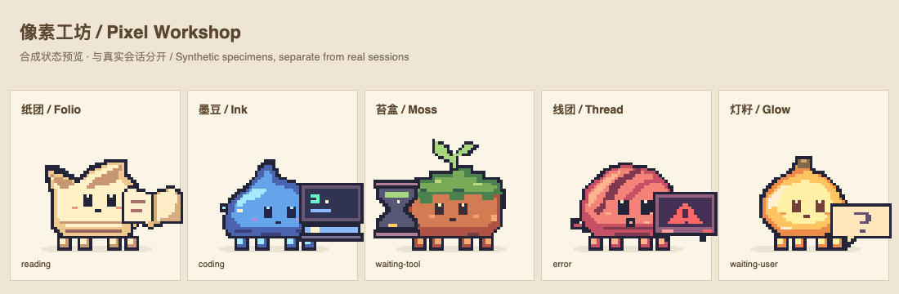

# AI Work Space v0.25.0 — Companions and a more resilient studio

Watch real, independent AI sessions and their helpers in a local macOS studio. This release brings the current Pixel and Painted companions, room interactions and observation improvements into a new downloadable build.

<picture>
  <source media="(prefers-reduced-motion: reduce)" srcset="https://raw.githubusercontent.com/Ye-0413/AI-Office-Workspace/v0.25.0/docs/animations/pixel-overview.png">
  
</picture>

The preview uses synthetic sessions and does not show a real user's work. [Both avatar styles and recording details](https://github.com/Ye-0413/AI-Office-Workspace/blob/v0.25.0/docs/animations/README.md).

## What's new

- **Pixel and Painted companions:** switch styles in the View menu or room preferences. Five characters cover eleven activities in each style; the motion gallery lets you explore the 55 activity loops per style. Pixel is the default.
- **A room that responds:** greet a companion, enjoy the occasional visitor or try the yarn ball. Keepsakes and decorations reflect eligible observed work; playful interactions do not create work events or progress.
- **More resilient observation:** connection status distinguishes configuration from real evidence. The connection panel can identify and repair old paths for integrations owned by the app, and reports observation drops without changing the AI tool's execution. Stale sessions retain their identity instead of being treated as completed work.
- **Readable families:** helpers inherit their family's appearance, and nameplates show observed activity and actual relationships. Manual sizing remains available; when the main cast needs space the room can temporarily use 90% of the selected size, then restore it.
- **Local history and usage:** browse observed activity and daily/weekly token totals from supported local sources. Observation remains passive; supported native questions require an explicit user answer, and tool approvals stay in the original client.
- **Quiet modes:** hidden-window pauses, reduced motion, low power and bilingual controls remain available.

## Download and install

Download **AI-Work-Space-0.25.0-arm64.dmg** or **AI-Work-Space-0.25.0-arm64.zip** and move **AI Work Space.app** into Applications. The package includes Electron and Node; no development server is required. Existing app data remains in the AI Mini Office user-data directory.

The locally built packages target **macOS 13+ on Apple Silicon**. They are **ad-hoc signed and not Apple-notarized**. Download `SHA256SUMS.txt` alongside the packages to check their hashes. Intel macOS, Windows and Linux packages are not part of this release.

The 28-entry provider catalog has configuration and event coverage; this does not mean every native client and version has been verified end to end. Connection status and displayed activity depend on the evidence each tool supplies. See the [monitoring guide](https://github.com/Ye-0413/AI-Office-Workspace/blob/v0.25.0/office/docs/monitoring.md) for boundaries and supported native questions.

Source remains **AGPL-3.0-only**, with upstream and third-party notices retained. Character and other artwork have their own terms; see [Originality & licensing](https://github.com/Ye-0413/AI-Office-Workspace/blob/v0.25.0/ORIGINALITY.md) and the [workshop artwork notice](https://github.com/Ye-0413/AI-Office-Workspace/blob/v0.25.0/office/assets/WORKSHOP-ARTWORK-NOTICE.md).

## 简体中文

**v0.25.0 带来像素与手绘伙伴，以及更稳定的本机观察。**

- 在菜单或房间偏好中切换像素与手绘风格；五位伙伴各覆盖十一类活动，每种风格的动作图鉴各有 55 套活动循环。默认使用像素风。
- 可以与伙伴打招呼、使用毛线球，或等待偶尔来访的客人。纪念物与装饰来自符合条件的真实观察记录；互动不会制造工作事件或增加进度。
- 连接面板区分已配置与真实事件证据，可修复应用拥有的旧路径并报告观察丢失。信号过期不会被误当作任务完成。
- 分身继承家族外观，名牌显示真实活动与关系。可手动调整大小；主角需要空间时可暂时使用所选尺寸的 90%，之后恢复。
- 本机提供活动记录及受支持来源的今日／本周 Token 用量。观察保持被动；受支持的原生问题必须由用户明确回答，工具审批仍在原客户端进行。
- 保留中英文、减少动作、节能以及隐藏窗口暂停。

从发布页面下载 **DMG 或 ZIP**，将 **AI Work Space.app** 移入「应用程序」。适用 **macOS 13 及以上、Apple Silicon**，无需开发服务器；原有数据继续保存在 AI Mini Office 用户数据目录。安装包采用 **ad-hoc 签名，尚未经过 Apple 公证**；可下载 `SHA256SUMS.txt` 核对。此次不提供 Intel macOS、Windows 或 Linux 安装包。

28 种接入方式的配置及事件检查不代表所有真实客户端和版本均已完成端到端验收。源码许可为 **AGPL-3.0-only**，美术适用各自声明；详情见[监测说明](https://github.com/Ye-0413/AI-Office-Workspace/blob/v0.25.0/office/docs/monitoring.md)及[原创与许可](https://github.com/Ye-0413/AI-Office-Workspace/blob/v0.25.0/ORIGINALITY.md)。
