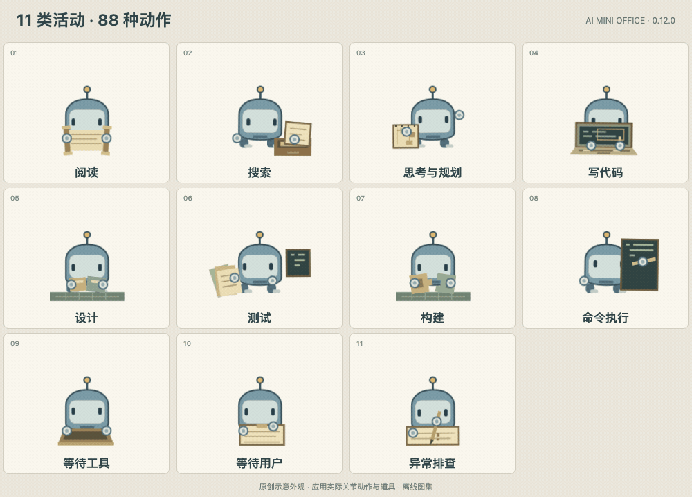

# AI Mini Office / 小小工作室

A local macOS playground for watching independent AI sessions inhabit a tiny office. Designed for a five-inch 1280×720 secondary display.

## 当前动画展示

**11 类活动，每类 8 种，共 88 种动作。**



[打开全部 88 种动画 GIF 图鉴](../docs/animations/README.md)。公开预览使用原创示意外观，动作和工作道具来自应用当前代码；不包含受限原角色素材。图集为离线演示。

## 一键初始化观察配置

打开右上角「连接 AI 工具」，点击 **一键初始化**。应用会检测已有工具及已安装的观察配置，串行安装或更新，显示逐项成功、失败与跳过结果；未检测到的工具不会新建配置目录。「重试失败项」只处理失败的工具。批量初始化与单项连接／移除互斥，连续点击不会启动重复安装。应用启动和打开面板只读取状态，不会自动改配置。

此入口复用各工具已有的配置写入机制：保留用户设置与其它 hooks、按需备份、检查文件锁和未知格式，不改变审批策略、不发送 AI 消息。配置完成与真正收到活动分开显示；Codex 的 hooks 信任确认、部分工具的新会话或重启要求，会保留在逐项详情里。无法安全写入的配置会报告失败，不会覆盖修复。

## 角色辨识、大小与每日活动

右上角的 **使用记录** 保存本机实际观察到的 Agent 档案与事件时间线，可按香港日期、AI 工具和主／分身筛选，分页查看或导出全部筛选结果的 CSV。记录包含身份、父子关系、项目名、活动与末次状态、轮次、工具调用、失败记录，以及分别统计的观测工作和等待时长；昵称跟随中英文界面。档案会在应用重启后保留，不会把历史 Agent 重新放进房间。

数据库保存在本应用用户数据目录的 `usage-history/usage.sqlite3`；面板中的「打开日志文件夹」可直接定位。使用 SQLite 事务与 WAL，目录权限 0700、文件权限 0600，默认保留全部历史。仅接受经会话状态模型确认的观察事件，跨重启去重；不保存对话正文、任务标题、提示词、工具输入输出或完整项目路径。旧版每日统计只有不可逆身份摘要，不能转换成完整使用档案；明细从本版本实际观察起积累。

时长只累计应用实际观察的活动区间，五秒检查点、正常退出补齐，香港午夜按日拆分；应用关闭、无信号超过三分钟和旧日志回放不补算工作。工作时长不含等待，工具并行不会让同一 Agent 重复计时。轮次和调用基于实际观测边界，不是 token、费用或完整客户端历史。异常退出保留已提交事件，最多丢失最后检查点后的时长。读取或写入失败会在记录按钮和面板中明确提示。筛选后的时长与次数只算所选日期，首次／末次观察与末次状态属于该身份全历史。

每个当前主 Agent 家族有独立的身体颜色，分身使用同色系；名牌保留组号和真实父子关系，超过八个同时出现的家族时可用组号继续辨识。中文昵称由神话、山海、星宿与文房意象组成 32,768 种四字组合，英文模式使用独立英文昵称。昵称只影响工作室显示，不改原始会话。

家族染色后，手心使用同色系的较深色，手部保留清晰细边，眼睛和工作道具维持自身颜色。所有项目、主 Agent 与分身同时站在同一个视觉平面，身体、名牌使用相同尺寸，不按家族深度缩小、不分页隐藏。旧版保存的项目筛选不会隐藏其它项目的当前角色。

「房间偏好 → Agent 大小」为 65%–135% 的偏好值。人数较多时全体等比例适配，并在页脚显示实际比例；所有角色与名牌的完整包络必须同时放得下。已有身份保留足点，活动变化只改变动作与工作区域说明，不直接换坐标；缩放用可中断的连续过渡。新身体按当前实际包络检查入场，不依赖可能长期阻塞的交通队列。普通心跳和场景切换保留原身体、图片、关节动画与已累计的播放时间。

只有主 Agent 的入场轨迹来自门口；新分身的轨迹来自已观察到的祖先，归位轨迹也回到同一家族。安全席位上的身体不会因展示这些轨迹而长期隐身。已完成分身保留底层开放会话，后续收到明确活跃但尚未分类的活动也会重新显现，不会被“工作种类未知”误藏。

主 Agent 重新活跃会撤销旧的等分身离场请求；分身归位期间的新工作会保留原关节、道具和动画进度。切换语言造成的名牌增长和调整尺寸只取消过时路线，不截断仍在进行的回收。外部角色图片加载失败时，原创备用身体在相同关节与坐标下继续显示；后续真实状态刷新会有限重试，图片恢复通过短透明度过渡衔接。备用身体不依赖失效图片，也不改变观察到的任务状态。

背墙显示醒目的香港时间和「今日活跃 Agent」，按香港自然日对实际观察到有活动的主 Agent、分身分别去重；同一身份执行多轮只计一次。统计保存在本机，重启后保留，香港午夜开始新一天。它统计应用观察到的活动，不会回扫整天历史，也不代表所有打开的聊天窗口；纯元信息、装饰访客与未被接受的事件不计入。磁盘只保存日期与哈希身份，不保存任务内容，最多保留十四天。

## 公开源码版准备

公开仓库不含受限角色素材和原图标。先运行 `npm ci`，再执行 `node scripts/prepare-local-artwork.cjs --from /absolute/path/to/original-project`，核验并导入你有权使用的本地素材。随后运行测试、启动或构建。

## 本地体验

打开构建产物中的 **AI Mini Office.app**；使用 DMG 时先将应用拖进「应用程序」，再打开并连接 AI 工具。应用只有「实时观察」，只读观察最近的本地 Codex 会话；每个独立 session 是一个角色，子 Agent 来自真实父子关系。空房间不会自动生成模拟任务。

没有伙伴在场时，初始界面只展示完整的空工作室和右上角控制区。连接与偏好从右上角打开为木框纸色面板；语言切换也在同一区域。历史闲置任务不会触发中央欢迎卡片。真实伙伴全部离场、空闲 8 秒后，会有一位明确标记的装饰访客来串门：在 10 个角落随机停留，翻书、喝咖啡、看看植物，偶尔变个小魔术。500 条独立撰写的中英双语气泡按区域轮换，真实工作出现即让路；逛约两分半后离开，过一会儿再来。可在右上角偏好中关闭「闲时串门」。访客不会加入任务数、伙伴列表或真实事件记录。

每个任务 ID 对应固定的一对中英文昵称；中文界面显示中文昵称，英文界面显示英文昵称，切换语言不会改变真实会话身份。任务描述变化、重新入场和重启不改变昵称映射。只有独立主 Agent 从门口入场；新分身从所属主 Agent 身体位置出现，结束后走回主 Agent 并显示「结束分身。」。嵌套分身保留实际父子连线，统一回到所属主 Agent；主 Agent 会等分身归位后离开。缺少可见主 Agent 时使用已知父级或原地过渡，不虚构门口入场。

Codex 的线程 UUID 与每轮 ID 分开识别，子 Agent 日志中复制的父会话历史不会覆盖角色身份。Thinking 期间保持同一个循环动画；短暂工具调用的过期路线会取消，目的地稳定后再起身行走。Codex 脚本中包装的修改、命令、测试也会识别；在刷新间隔内已结束的真实工具动作，会在原地短暂呈现「刚刚在改代码」等有依据的动作，不触发来回奔走。主任务与各级子任务使用同色铭牌、持续可见的箭头连线和父角色名称；伙伴列表按树形排列，点击详情中的父角色可直接定位。

继续几周前创建的 Codex 对话时，活动仍写入原始日期目录。观察器会分批扫描历史目录，重新打开工作室也能发现最近恢复的旧会话；不会把创建日期当成活跃日期。所有项目的当前主 Agent 与分身同时显示，同一个 Codex 下的多个 session 保持独立身份；伙伴列表和详情保留原始项目、ID 与父子关系。

在房间设置中选择 1280×720 副屏，再通过原生窗口绿色按钮进入全屏。角色在稳定席位呈现阅读、规划、写代码、测试等实际活动，并在同一活动中经历不同动作段落。动作导演结合实际并行工具数量、子 Agent 和工具结果产生反应，优先呈现工具结果与生命周期变化；没有结果时不会假装成功。

右上角 **EN / 中文** 切换界面语言，并保存到本机。昵称随界面语言切换；任务原文、项目名称和 ID 保持原样。

「连接」面板可搜索并接入 28 种工具，包括 Hermes Agent。工具目录在测试时检查、构建时从项目工具注册表同步；事件适配、普通 hooks、插件及特殊配置分别处理。只有点击「连接」才会安装该工具的被动观察入口；「移除配置」只卸载本应用拥有的部分。工具审批继续由原工具处理。接入后需要在相应工具中产生新事件；Hermes 会核验本机 Gateway 并热加载 11 个观察钩子，已经启用的插件也可通过「重新加载」重新接入，通常无需重启 Gateway。未确认热加载时会明确提示；其他插件可能需要新会话或手动重启宿主，应用不会自动重启 AI。移除 Codex hooks 后，本地只读观察仍可继续。

28 种接入方式已做隔离配置和事件回归检查；这不表示 28 种真实客户端都已运行。Codex 已验证真实多 Agent 日志到角色显示，其他客户端仍需实际会话验收。各工具的宿主版本、配置路径与已知边界见 `docs/upstream-compatibility.md`。KiroCrew 的网关、目录和配置锁使用随应用打包的 macOS 原生小程序，无需额外 Python。

房间默认跟随香港时间，晨曦、上午、午后、日落和夜晚使用连续的天色与室内灯光。左侧木窗与门上的玻璃都能看见海港剪影，慢云、渡轮、城市灯与海面反光保持在窗内。背墙木框钟使用醒目的 51px 数字，同时显示香港完整日期与星期；挂钟指针也与真实香港时间同步。中英文日期随界面语言切换，香港午夜会自动更新。点击时钟可预览时段，再用「回到此刻」恢复实时；预览期间时钟仍显示真实香港时间、日期和星期。减少动作、节能和隐藏窗口都会暂停装饰循环，不改变真实任务状态。

中文昵称提供 32,768 种神话与传统意象四字组合；英文昵称保留 8,192 种独立组合。昵称随界面语言切换，不再需要单独选择风格。每个身份还有固定的小性格、纪念物和问候，任务详情保留原始标题与 ID。「打个招呼」只触发工作室里的回应。主 Agent 下方显示「分身 X 活跃 · 累计 Y」；累计按完整身份去重，包含本次观察中已经结束的分身，跨房间切换仍保留。真实子任务本轮完成也会收回身体，保留仍开放的底层会话；同一身份接到新工作后重新分身，累计不重复增加。普通闲置、失联、缺少快照都不会被当成已结束；新工作可以中断归位。

观察日志轮换时会先按文件身份排空保留文件的未读尾部，再读取新文件；每轮仍最多读取 64 KiB。损坏行和不同文件的 JSON 碎片会被隔离。GitHub 的 Office quality 工作流在 main 推送和 PR 上安装锁定依赖、重建原生锁并运行回归测试；公开源码检查无需还原角色素材。

头像覆盖十一种真实活动，**每类八套，共 88 套原创关节动作**：思考与规划、阅读、搜索、写代码、设计、测试、构建、命令执行、等待工具、等待用户及错误。托腮、转笔、分解方案、推演分支；打字、调试、重构、核对补丁；展开卷轴、翻目录卡、检查测试边界、绕线装配等场景使用不同的道具及眼手脚编排。同一活动按约 18–24 秒可见工作时间自然轮换，普通事件刷新不会重启动作。每个完整身份分别累计各类活动时间，切换场景后会继续轮换，不重复从首个动作开始；离屏时间不算作工作时间。姿态与道具切换保留可中断的短暂衔接，工具结果和生命周期反应继续优先。动作只引用本地静态角色素材，不将受限 SVG 内容写入源码；减少动作、节能、隐藏、走路或离场时会暂停轮换。

## Run and build

```sh
npm ci
npm test
npm start
npm run build
npm run verify:bundle
npm run verify:renderer
npm run verify:packaged-hook
npm run verify:packaged-flow
npm run build:mac
```

The `.app` is generated in `../dist-mini-office/mac-arm64/`. The application contains Electron and its Node runtime; a packaged app does not require a separately installed Node or a running development server. `build:mac` also produces DMG and ZIP artifacts. Apple Silicon is the local verification target; an Intel build command is provided separately. Local builds use ad-hoc signing and are not notarized distribution releases.

## Observe real work

The default mode is **实时观察**. A read-only, bounded Codex rollout observer discovers recent local activity. Each session and reliably identified child agent has its own identity. There is no demonstration store, synthetic task timer, mode switch or demo IPC in the application. Synthetic events exist only in isolated regression fixtures.

Each of the eleven activity families has eight authored choreographies, for 88 total. Props and joint motion distinguish reading, search, planning, coding, design, testing, builds, execution, tool waits, user waits and error inspection. A bounded per-identity clock keeps each activity's accumulated visible work across page and room navigation. Offscreen and quiet intervals do not advance the cycle; metadata does not replay it.

The connection panel installs optional passive observation hooks only when explicitly selected. It preserves existing hooks and native approval behavior. Codex hook trust must still be reviewed in Codex; this app does not write trust hashes or approve tools. Unknown Cursor host versions use a conservative observation subset. Claude Code must be available and run a real session before its end-to-end connection can be considered verified.

Tool starts, correlated results, user input, child agents, turn endings and session closures remain distinct. A quiet or stale source is not a completed task. Unrecognized events are retained as diagnostic uncertainty rather than invented animation claims. A successful command does not prove an entire compound test workflow succeeded.

An unanswered question keeps its attention state while parallel tools continue. If a waiting event has no reliable call identifier, an unrelated result cannot prove it was answered: the last observed wait remains until an explicit new turn, interruption, session closure or matching elicitation response. A stale source is labeled as a lost signal.

Open the room preferences to move the window to a secondary display. Use the native green window control or the Display menu to enter full screen. You can preview Hong Kong daylight, change rain, use reduced motion or low-power behavior, and scale agents with their nameplates from 65% to 135%. Family body colours and numbered badges preserve real root/helper relationships. Layout reserves complete character and nameplate envelopes; movement queues and temporary yielding avoid occupied bodies. Brief clone split/merge overlap is intentional.

The larger Hong Kong clock sits beside a daily activity ledger. It counts distinct observed active identities per Hong Kong calendar day, with separate main-agent and clone counts. Repeated turns count once and app restarts retain the day. It does not rescan the entire day or enumerate every open chat window. Private local persistence stores dates and hashed identities, retains at most fourteen days, and excludes decorative visitors, plain metadata and rejected events.

## Local data and credits

Presentation preferences and a normalized event spool live in the application's local user-data directory. Each provider's spool rotates at approximately 8 MiB and retains one backup; simultaneous writes can briefly exceed the threshold. Ordinary appends do not compete for a lock. A rotation conflict can drop an observation, with the connection panel reporting a blocked rotation; AI execution continues. The collector drops full tool output and replies; task titles are bounded to a short first line. No cloud service, AI API key or telemetry is required. `MINI_OFFICE_DATA_DIR` can point to an isolated directory for local testing.

The original source is AGPL-3.0-only. Character artwork has its own restrictions; see `assets/ORIGINAL-ARTWORK-LICENSE.txt` and `UPSTREAM-NOTICE.md`. The office background was generated with the built-in image tool; its prompt and source are preserved in `docs/office-art-prompt.txt` and `assets/office-room-source.png`. This public source export omits restricted character artwork and the upstream icon. Restore them only from an authorized local source with `scripts/prepare-local-artwork.cjs`; their separate license still applies.

Protocol sources, fixtures and verification boundaries are recorded in `docs/provider-events.md`. Completion evidence is tracked against the full requested scope in `docs/goal-evidence.md`.

`verify:packaged-flow` uses the built application's runtime and ASAR modules to replay synthetic Codex, Cursor and Claude Code hook events through the collector, bridge, session store and room rules. It does not open a GUI, run a real AI task or install global hooks; its result must not be described as live-client verification.

## 节令场景与机关

通过上方场景选择山海工坊、港湾茶舍或星台观测室。山海工坊随节令切换 43 幅完整主题画面，桌面、墙面、织物、灯光与窗外各有主题陈设，家具及通道保留统一布局；港湾茶舍和星台保留自己的室内画面与节令布景。每种场景有三种原创机关及三套双人小互动。上方「节令」提供 43 套主题机关、自动日期选择，以及关闭／雨／雪／随主题天气；设置保存在本机。机关的可见状态、轨迹和道具各有区别，标准播放使用 41 个连续姿态采样；双人互动持续 2.8–3.2 秒，不发送 AI 消息、不制造任务或工作结果。

[公开机关动画与完整清单](../docs/scenes/README.md)。自动模式使用香港日期：四季按月份，已核实节日优先，手动灵感主题不臆测地区花期或变化中的宗教节日日期。清明精确日期由香港天文台 2026–2035 表提供，范围外保留手动预览。雨雪为装饰，不是实况天气；减少动作、隐藏窗口与节能设置会停止装饰循环。切换主题不改真实 Agent 的位置、身份与动作时钟。背景在解码完成后从当前透明度衔接；快速连选时，已退场画面保持自己的短暂淡出时间，较晚解码的旧选择不会覆盖新选择。
